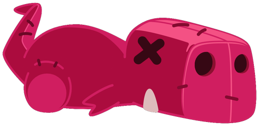

# RIVINATOR 6000



A browser tool for inspecting Rive `.riv` files in **@rive-app/canvas 2.37.6**, the web runtime our games ship. Open the page, drop a `.riv` on it, and play it the way the game does.

Files never leave your browser: nothing is uploaded anywhere.

## What it does

- **Data:** the artboard's view model as one tree.
  - The main view model's triggers fired from code (no data bind in the file writes them) sit on top as large green buttons, `activate` first. Nested view models keep theirs in the tree and on their cards.
  - The main view model (its name contains "main") comes next, in larger rows: its triggers and values set from code are cards in two columns, tinted with their type color, ordered trigger, number, enum, boolean, string (click a trigger card to fire it, a boolean card to toggle it). Then every nested view model.
  - Inside each view model, values set from code come first, marked with a green **runtime** tag; values Rive sets follow, then events.
  - Every value is editable and every trigger can be fired.
- **Colors by type:** view model brown, number blue, string red, boolean yellow, enum purple, trigger green (fired from code), event cyan (fired by Rive, through actions or property groups bound object to source), qa_ triggers orange.
- **How origins are read:** the inspector reads the data binds stored in the `.riv` itself. A property that a bind writes (target to source, or two-way) is set by Rive; everything else is set from code. If the file later fires or changes something it classified as set from code, it moves it over.
  - Writes from a state machine layer named **DEMO** don't count: a trigger or value only a DEMO layer writes stays a runtime one (its fires show as `demo` in the log). Anything also written from another layer or a listener is still set by Rive.
  - `activate` always leads the buttons on top, wherever it is and whatever sets it.
- **Player:** the artboard running in 2.37.6, sized for portrait (mobile) artboards. Pick the artboard, state machine, view model instance and fit, and play at 0.25× to 4× speed.
- **Texts:** view models whose name has "bind" or "text" (localization strings) get a compact window above Nested objects: `Language` as a card on the left, every other string as a short editable line.
- **Nested objects:** a card for every nested view model that is bound to an artboard (a component such as a cup or a prize). Each card shows:
  - that artboard as a live thumbnail
  - its triggers, one click to fire
  - its strings, numbers and enums, editable in place

  A card flashes when a trigger inside it fires, and the card with the latest trigger moves to the top.
- **Trigger activations:** every view model trigger the file fires, with time and frame, subscribed with `.on()` the way the game integration listens.
- **qa_ screenshots:** each `qa_` trigger is screenshotted the frame it fires. Click its row in the log to see it, step through all of them, and save any as PNG.
- **Recording:** record the artboard (or the whole tab) to MP4, with the sound the file plays.

Panels are resizable: drag the bars between them; double-click a bar to reset it.

## Running it locally

The page needs to be served over http (browsers do not load `rive.wasm` from a `file://` page):

```bash
python3 -m http.server 8000
```

Then open http://localhost:8000.

## Files

- `index.html`: the whole tool (HTML, CSS and JavaScript in one file). The runtime script loads from unpkg, pinned to `@rive-app/canvas@2.37.6`.
- `rive.wasm`: the matching 2.37.6 WebAssembly runtime, served next to the page.

To move to another runtime version, change the version in the `<script src>` URL and replace `rive.wasm` with the same version's file from `https://unpkg.com/@rive-app/canvas@<version>/rive.wasm`.
